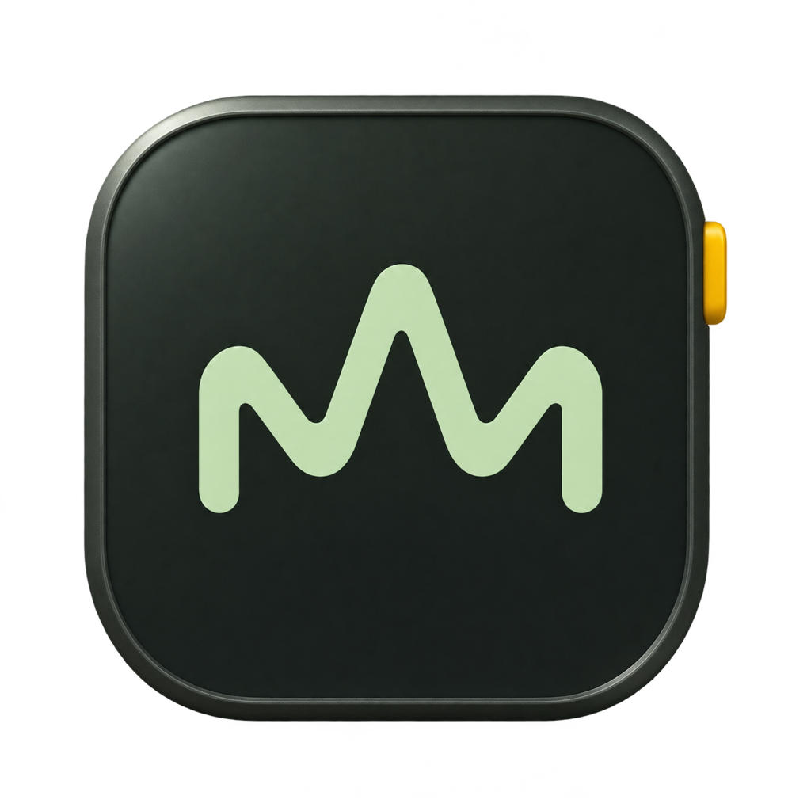
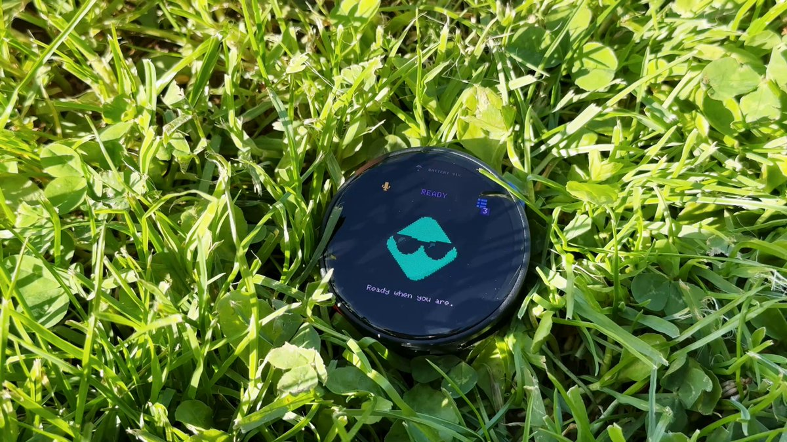
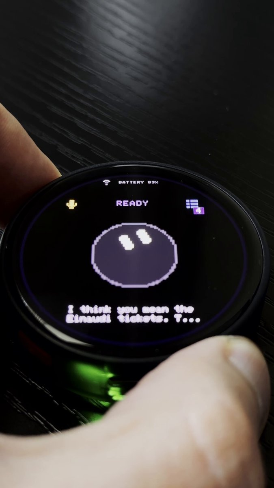
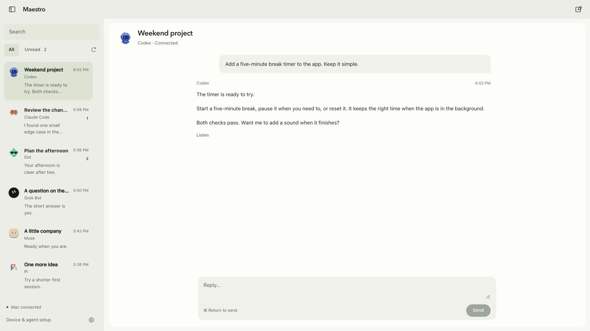
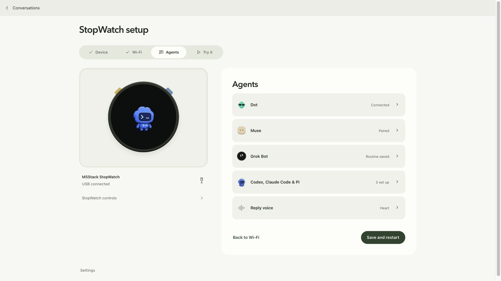
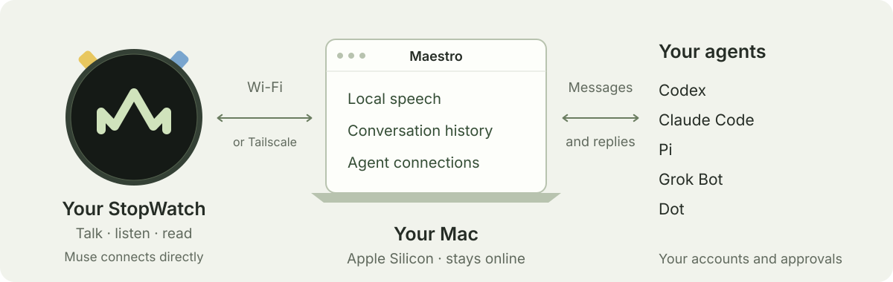
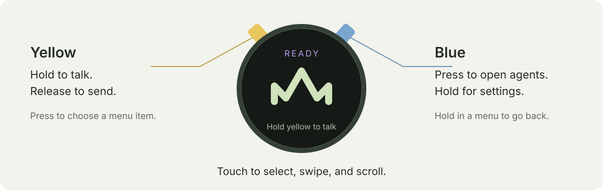

<p align="center">
  
</p>

<h1 align="center">Maestro</h1>

<p align="center">Talk to your agents from your StopWatch.</p>

<p align="center">M5Stack StopWatch C152 · Apple Silicon Mac</p>

<p align="center">
  <a href="#build-from-source">Get started</a> ·
  <a href="#see-it-in-action">Demos</a> ·
  <a href="#on-your-mac">Screenshots</a> ·
  <a href="#how-it-works">How it works</a> ·
  <a href="CONTRIBUTING.md">Contribute</a>
</p>

Choose Codex, Claude Code, Pi, Grok Bot, Dot, or Muse. Hold the yellow button
to talk, then release to send. Hear the reply or read it on the watch.
Replies stay in a shared Mac and watch inbox.

## See it in action

<p align="center">
  <a href="https://x.com/max_grev/status/2109088460082684310"></a>
  <a href="https://x.com/max_grev/status/2109427651027083373"></a>
</p>

<p align="center">
  <a href="https://x.com/max_grev/status/2109088460082684310">Watch the introduction · 33 seconds</a>
  &nbsp; · &nbsp;
  <a href="https://x.com/max_grev/status/2109427651027083373">Watch the agent demo · 36 seconds</a>
</p>

## On your Mac

Read saved replies, follow unread conversations, and continue supported agent
sessions from the same app.

<picture>
  <source media="(prefers-color-scheme: dark)" srcset="docs/images/mac-conversations-dark.jpg">
  <source media="(prefers-color-scheme: light)" srcset="docs/images/mac-conversations-light.jpg">
  
</picture>

Connect the StopWatch, join Wi-Fi, and set up the agents you use.

<picture>
  <source media="(prefers-color-scheme: dark)" srcset="docs/images/mac-setup-dark.jpg">
  <source media="(prefers-color-scheme: light)" srcset="docs/images/mac-setup-light.jpg">
  
</picture>

*Screenshots use sample conversations and connection states.*

## How it works



The Mac runs Whisper for transcription and Kokoro for reply speech. Your
chosen agent receives the message through its own connection and account.
Muse uses the watch's native SDK connection and its agent's voice.

Maestro is experimental. It needs an Apple Silicon Mac running macOS 14 or
later, a StopWatch C152, a USB data cable, and 2.4 GHz Wi-Fi. The Mac handles
speech, agent connections, and storage. Keep it powered and online.

## Build from source

Install Xcode command-line tools (`xcode-select --install`) and
[Homebrew](https://brew.sh), then install the prerequisites:

```sh
brew install node@24 python@3.13 lame
export PATH="$(brew --prefix node@24)/bin:$PATH"
git clone https://github.com/maxgrev/maestro.git
cd maestro
bash scripts/bootstrap.sh
npm start
```

Open <http://localhost:4210/setup.html>. Bootstrap downloads pinned tools and
speech models, installs local dependencies, builds generic StopWatch firmware,
and creates your private configuration. It can take several minutes and needs
an internet connection. It never flashes your device or signs in to a provider.
Run it again to resume an interrupted download or build.

Maestro supports Node 24 and 26. Python 3.13, Git, Clang, and LAME must be on
`PATH`.

To build the native Mac app after bootstrap, use macOS 26 or later with
Xcode 26 or later, then run:

```sh
npm run app:build
open dist/Maestro.app
```

This creates a local development build. Public Mac downloads need Developer
ID signing and notarization; see [release instructions](docs/releasing.md).
The app bundles its runtimes, speech models, and generic firmware, so its
users do not need Homebrew or a terminal.

## Set up the StopWatch

1. Connect USB. Choose the device, confirm it is an M5Stack StopWatch, and
   install Maestro. The installer verifies and saves a recovery image before
   writing. Keep the cable connected until installation ends.
2. Join a 2.4 GHz Wi-Fi network or phone hotspot. For use outside your home,
   enable **Away from home** with Tailscale and keep the Mac online. An iPhone
   hotspot may need **Maximize Compatibility**.
3. Connect at least one agent below. Save the Mac connection to the StopWatch
   over USB. Use your own provider accounts and subscriptions.
4. Choose an agent, hold yellow, say a short message, and release. Check both
   the text and audio response.

The native app stays open when its window closes. Use its menu-bar item to
reopen it; quitting stops the bridge. Source installs need `npm start` to
keep running. Leave a Mac laptop powered with its lid open.

| Agent | What you need |
| --- | --- |
| Codex | Install and sign in through setup. Choose and explicitly trust a project folder. Uses new or existing Herdr sessions. |
| Claude Code | Install and sign in through setup. Its folder and tool approvals still apply. Uses Herdr sessions. |
| Pi | Install through setup and use a saved provider account or API key. Automated tests cover its reply reader; live account acceptance is still pending. |
| Muse | A Muse SDK token and pairing through the Muse phone app. [Muse setup](https://gadgets.muse.ai/) uses that provider's terms. |
| Grok Bot | A routine webhook and an active Mac connection for its reply helper. Use the personalized instruction in setup. [Grok guide](docs/grok-bot.md). |
| Dot | ChatGPT Dot and custom MCP plugin access, plus Tailscale remote access. [Dot guide](docs/dot.md). |

You only need accounts for the providers you choose. Speech runs locally.
Coding-agent work stays in Maestro's configured Herdr instance;
some local sessions started elsewhere can also contribute replies to the
[inbox](docs/inbox.md).

## Controls and voice



Yellow records while held, confirms menu choices, and pages up in a reply.
Blue opens the agent list, moves down through menus and replies, and opens
settings when held. Hold blue in a menu to go back. Touch supports selection,
swiping, and scrolling. Volume and mute live under **Settings → Sound**.

Tap reply text to read the full answer. Muted replies open the reader
automatically. **Agents → Inbox** holds saved replies and unread badges;
background work never interrupts the active conversation or starts speech.

Choose a local voice under **Agents → Voice**. whisper.cpp transcribes on the
Mac, and Kokoro speaks replies locally. The included reply voices speak
English. Muse uses agent-supplied audio when available. Recording upload
starts on release; Maestro waits for an agent's final answer before speaking.

## Data, networking, and recovery

Source installs keep private data in `.local`; the app normally uses
`~/Library/Application Support/Maestro`. A development app beside the repo
can reuse `.local`. `MAESTRO_DATA` selects another source-install data folder.
Never publish these folders: they contain keys, transcripts, and backups.

Setup uses localhost port 4210. Devices use authenticated HTTPS on port 4211;
Tailscale remote access uses the separate loopback listener on port 4212.
Never tunnel port 4210. The watch stores one Wi-Fi network; changing it needs
USB. Local certificates last one year. See [security and renewal](SECURITY.md).

The installer saves a 16 MB recovery image and checksum under
`backups/<chip-mac>/` in the private data folder. Keep it for that exact board.
Reconnect USB and retry an interrupted installation. Maestro never repeats
an uncertain agent task automatically.

Flash encryption and secure boot remain off to preserve USB recovery.
Physical access to the StopWatch or its backup can expose stored credentials.

## Development and releases

```sh
npm run check
npm test
npm run firmware:build
.tools/python/bin/python -m unittest discover -s scripts/tests -v
python3.13 scripts/package-firmware.py
npm run release:source
```

CI tests Node 24 and 26, builds the StopWatch firmware, runs the Python/C
checks, and smoke-tests a relocated Mac package with real local speech. The
character test needs the prepared SDK; bootstrap supplies it. CI does not
flash hardware or authenticate provider accounts.

See [contributing](CONTRIBUTING.md), [release and signing instructions](docs/releasing.md),
and the [project overview](docs/project-overview.md). Mac-off operation,
microphone streaming, full-duplex voice, phone Wi-Fi provisioning, and broader
hardware support remain future work. Second-Mac setup, human speaker and
battery checks, and live Pi account acceptance still need physical testing.

## License

Maestro's original code uses the [MIT license](LICENSE).
[Third-party notices](THIRD_PARTY_NOTICES.md) cover dependencies and artwork.
The existing Codex companion and native Muse artwork retain their own rights;
confirm their redistribution terms before publishing source or binaries.
Publish matching third-party source beside any Mac binary. Provider names
identify integrations and imply no endorsement.

To export a source snapshot, use `npm run release:source` and follow the
[source publication instructions](docs/releasing.md#publish-source-safely).
