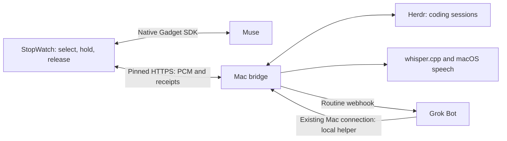

# Maestro design and implementation notes

Implemented October 9, 2026. The initial research plan became a thin ESP-IDF extension and one TypeScript process on the Mac.

**Reuse**

The official [Muse Gadget SDK](https://github.com/facebookincubator/muse-gadget-sdk/tree/d7e5d22bbd1cb8e6369310f72039247b76942e5a) already supports this exact board: display, touch, buttons, microphone, speaker, power, pairing, and its encrypted Muse connection. `scripts/prepare-firmware.py` applies anchored changes to a generated build tree; `firmware/src` owns the small Maestro additions. ESP-IDF and component versions are pinned. Updating the SDK is a deliberate task, not a build-time lookup of the latest version.

[Herdr](https://herdr.dev/docs/agent-automation/) handles coding process/session management. One also names Herdr in its [FAQ](https://getone.one/#faq). Maestro uses the supported `agent.prompt` API, never raw-key fallback for blocked agents. Daily Muse and Grok Bot use their own account connections, not similarly named coding products.

**Transport and speech**

The first implementation uses ordinary authenticated HTTPS requests: a bounded PCM upload, a saved request receipt, and polling for the result. Half-duplex recordings do not need a permanent WebSocket. At 16 kHz mono PCM16, a 20-second request is 640 KB. Muse retains its own native voice-note transport. Add [Opus](https://opus-codec.org/) only after bandwidth or power measurements justify it; [MQTT](https://mqtt.org/) would add a broker without solving provider chat access. Neither is needed for this local build.

Speech stays local to the Mac: whisper.cpp's multilingual base model for bridge transcription, macOS `say` and FFmpeg for speech output. Muse supplies its own transcription; its added spoken output uses the bridge's MP3 endpoint and the SDK's existing decoder. Text remains available if TTS fails. Bridge speech runs one operation at a time and reports busy instead of building an unbounded queue.

**Delivery**

SQLite in WAL mode stores request IDs, the chosen target, transcript, result, and state. The bridge reserves each conversation before sending work and persists Dispatching before a call that can create an upstream effect. A repeated UUID with identical content returns the same receipt; changed content fails. A crash after dispatch becomes Uncertain. No automatic action replay attempts to claim exactly-once execution across independent systems.

The device captures the target when recording begins. Refreshed menu rows own their target snapshots. Switching agents invalidates the old playback generation, while already submitted work can continue on the Mac. A successful New coding session request switches the device and web composer to the new conversation for follow-ups. Stopping speech or changing agents does not cancel upstream work.

Grok's webhook acknowledgment is distinct from completion. The authenticated reply helper handles final answers and needs-attention results, including a callback that arrives before the webhook acknowledgment. Grok runs the helper through its existing Mac connection; no public tunnel is needed. Live delivery and follow-ups passed. Because routine runs start fresh, the bridge supplies up to 12 completed exchanges from the same conversation's receipts, capped at 24,000 text characters. This survives bridge restarts and excludes unfinished actions and other agents' messages.

**Targeting limits**

Herdr target identity includes its terminal ID, agent kind, and session identity when available. The bridge rechecks before submission and checks again after completion. Herdr 0.9.3 lacks an atomic expected-session field in `agent.prompt`, so a narrow replacement race remains between validation and submission. Do not claim this is an atomic guarantee or reuse a pane while a Maestro request is in flight.

Herdr returns terminal output. Maestro displays it verbatim, rather than feeding terminal decorations or a stale answer to speech. For Codex, a read-only app-server client finds a completed turn with the exact input, project, and submission time, and uses only its final-answer items. Multiple or incomplete matches fall back to a completion notice and the terminal view. This client never starts threads, resumes them, or answers approvals. Other coding providers need a supported structured reply reader before they can speak full answers.

**Boundaries**

The local web page binds to loopback and rejects foreign Host/Origin headers. Device routes require a bearer token and TLS; Grok callbacks require their own key. Commands accept saved project and target IDs, not arbitrary shell commands. Local speech files are temporary and removed after use. Secrets, backups, and request history stay in ignored private directories. The generic firmware contains no personal keys; setup writes device credentials to NVS over USB.

The firmware preserves USB recovery by disabling automatic eFuse provisioning, encrypted-flash setup, and upstream OTA. These are development choices, not a production physical-security claim. Native Muse account pairing and a physical microphone/reply-playback test passed. Human speaker-quality review, touch behavior, and battery life remain acceptance checks.

No wake word, full-duplex echo cancellation, automatic AI router, adapter marketplace, hosted database, or new orchestration framework is included.
